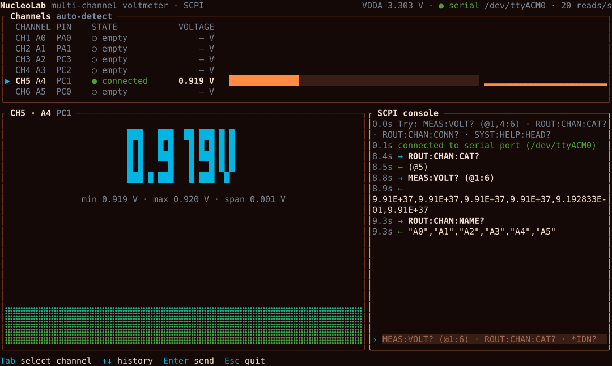

<h1 align="center">NucleoLab</h1>

<p align="center">
  A bench instrument on a Nucleo board: oscilloscope, signal generator, FFT / Bode analyzer<br>
  and a 6-channel voltmeter with plug detection, all driven over <b>SCPI</b>.<br>
  Bare-metal C on a NUCLEO-L452RE-P, a terminal UI in <a href="https://odin-lang.org">Odin</a> with <a href="https://github.com/Huseynteymurzade28/hnoss">hnoss</a>, and a first prototype in <a href="https://ziglang.org">Zig</a>.
</p>

<p align="center">
  
</p>

<p align="center"><sub><code>tui/</code>: a potentiometer on A4 is detected on its own, every other input reads as empty. Commands typed in the console go straight to the board.</sub></p>

## Features

- **Own SCPI / IEEE 488.2 parser**: no heap, no hardware dependencies, short and long forms, channel lists `(@1,3:5)`, binary blocks, error queue, status registers. Fuzzed with 2 million random tokens under ASan/UBSan.
- **Oscilloscope**: 1 MS/s, 12-bit, up to 8192 points, rising/falling trigger with pre-trigger, AUTO / NORMAL sweep.
- **Signal generator** on the DAC: sine, square (duty), triangle, ramp, DC and uploaded arbitrary waveforms, 1 Hz – 100 kHz.
- **On-board FFT**: spectrum, THD, SNR, SINAD. **Bode analyzer**: gain and phase of a circuit, point by point.
- **6-channel DC voltmeter with plug detection**: every Arduino analog pin A0–A5 is a channel. The board notices within ~200 ms when a wire is plugged in or pulled out.
- **Three ways to drive it**: the terminal UI, a web panel, or any SCPI client (PyVISA, `nc`) through the bridge on port 5025.

## Hardware

**NUCLEO-L452RE-P** (MB1319, STM32L452RET6P). Inputs take **0–3.3 V only**. PA4 is the generator output: never connect it to another output.

| Channel | Header pin | MCU pin | | Channel | Header pin | MCU pin |
|---|---|---|---|---|---|---|
| 1 | A0 | PA0 | | 4 | A3 | PC2 |
| 2 | A1 | PA1 | | 5 | A4 | PC1 |
| 3 | A2 | PC3 | | 6 | A5 | PC0 |

> [!NOTE]
> The plain NUCLEO-L452RE (MB1136) wires A2 to PA4 and A3 to PB0. On that board, change `chmap` in `fw/board/analog.c`.

> [!WARNING]
> On the -P chip, PC5 and PD2 are not GPIOs: those balls carry the external SMPS core supply. Writing their GPIO registers leaves the MCU unstable until a power cycle.

- **Scope self-test**: put a jumper from PA4 (morpho header; on the -P board it is not on A2) to A0. Without it, scope channel 3 reads PA4 internally.
- **Bode**: PA4 → 10 kΩ → A0, A0 → 10 nF → GND (cut-off 1.59 kHz). Don't go below 5 kΩ, the DAC buffer can't drive it.

## Quick start

```sh
git clone --recursive https://github.com/Huseynteymurzade28/nucleolab
cd nucleolab
python3 -m venv .venv && .venv/bin/pip install -r requirements.txt
make flash          # build and program the board (arm-none-eabi-gcc, st-flash)
./run.sh            # web panel: http://127.0.0.1:8080, SCPI: 127.0.0.1:5025
make tui && tui/nucleolab-tui
```

The TUI connects to the bridge when `./run.sh` is running (so the web panel keeps working), otherwise straight to the ST-LINK serial port (921600 baud). `Tab` selects a channel, `↑↓` walks the command history, `Esc` quits.

## Web panel

<p align="center">
  
</p>

Scope, spectrum and Bode views with cursors, CSV export and a SCPI console. The UI text is in Turkish.

## Voltmeter and plug detection

How does the board know a pin is empty? It doesn't wait for a reading to look "random". In the background it probes one input every 20 ms:

1. Charge the pin's own capacitance through the weak internal **pull-up**, switch back to analog, sample at once.
2. Do the same through the **pull-down**.

A floating pin keeps whatever charge it was given, so the two readings land far apart (~800 codes). A pin that something drives reads its own voltage both times (~0 apart). The threshold is 300 codes, and a change has to show twice in a row before it counts. Every change sets bit 9 of `STAT:OPER` and bumps a counter. The pulls are ~40 kΩ, so the test is harmless to whatever is connected.

| Command | Reply |
|---|---|
| `MEAS:VOLT? (@1,4:6)` | Volts on the listed channels. An empty channel returns `9.91E+37` (SCPI NaN). Without a list, `MEAS:VOLT?` is the scope's DC measurement |
| `ROUT:CHAN:CONN? [(@list)]` | `1` connected / `0` empty per channel (default: all) |
| `ROUT:CHAN:CAT?` | Connected channels, e.g. `(@1,4)` |
| `ROUT:CHAN:NAME? [(@list)]` | `"A0","A1",…` |
| `ROUT:CHAN:CHAN?` | Number of plug / unplug events so far |
| `DIAG:CHAN:PROB? [(@list)]` | Raw probe spread per channel |

```
$ nc 127.0.0.1 5025
ROUT:CHAN:CAT?
(@5)
MEAS:VOLT? (@1:6)
9.91E+37,9.91E+37,9.91E+37,9.91E+37,9.192833E-01,9.91E+37
```

## SCPI reference

| Group | Commands |
|---|---|
| Common | `*IDN?` `*RST` `*CLS` `*TST?` `*OPC` `*OPC?` `*WAI` `*ESR?` `*ESE` `*SRE` `*STB?` |
| Generator | `SOUR:FUNC SIN\|SQU\|TRI\|RAMP\|DC\|ARB`, `SOUR:FREQ`, `SOUR:VOLT`, `SOUR:VOLT:OFFS`, `SOUR:FUNC:DCYC`, `SOUR:DATA:ARB <block>`, `OUTP ON\|OFF` |
| Scope | `ACQ:CHAN 1–3`, `ACQ:SRAT`, `ACQ:POIN`, `ACQ:STAT?`, `TRIG:LEV`, `TRIG:SLOP`, `TRIG:SWE`, `TRIG:POS`, `TRIG:FORC`, `INIT`, `ABOR`, `WAV:PRE?`, `WAV:DATA?` |
| Measure | `MEAS:VOLT[:DC]?`, `:AC?`, `:RMS?`, `:MIN?`, `:MAX?`, `:PTP?`, `MEAS:FREQ?`, `MEAS:TEMP?` |
| Analysis | `CALC:SPEC?` (int16 centi-dBV block), `CALC:DIST?` (THD / SNR / SINAD), `BODE:POIN? <Hz>[,<ch>]` |
| Voltmeter | see above |
| System | `SYST:ERR?`, `SYST:VDDA?`, `SYST:UPT?`, `SYST:CLOC?`, `SYST:HELP:HEAD?`, `STAT:OPER…`, `STAT:QUES…`, `OUTP:LED`, `DIG:INP?`, `DIAG:CAL?`, `DIAG:LOOP?` |

Every command, as the board sees it: `SYST:HELP:HEAD?`.

## Zig prototype

`prototype/pot-adc/` is where this started: one potentiometer on A0, register-level Zig with no libraries. ADC1 averages 16 samples, VREFINT and its factory calibration give the real supply voltage, and the result goes out over USART2 as `P <raw> <mV> <vdd_mV>` lines. A small hnoss TUI draws it in big digits with a braille history graph.

```sh
cd prototype/pot-adc && zig build flash      # Zig 0.17
cd tui && odin run .                         # or ./watch.sh: read it with OpenOCD only
```

## Layout

| Path | What |
|---|---|
| `fw/scpi` | Portable SCPI core |
| `fw/board` | Clock, UART, ADC / DAC / DMA, plug probe |
| `fw/app` | Instrument commands, measurements, FFT, Bode, voltmeter (`dvm.c`) |
| `host` | Bridge (serial ↔ TCP 5025 + web), web panel, PyVISA example |
| `tui` | Terminal UI (Odin + hnoss) |
| `prototype/pot-adc` | First version: Zig firmware + its TUI |
| `tests`, `tools` | Parser tests and fuzzing on the PC, on-board tests |

## Tests

```sh
make test                           # SCPI parser: unit tests + fuzzing, ASan/UBSan
make board-test                     # these talk to the board: stop the bridge first
.venv/bin/python tools/lab_test.py
.venv/bin/python tools/bode_test.py
```

## Limits

- The DAC and ADC share one reference and clock, so measuring yourself doesn't prove absolute accuracy.
- No anti-alias filter: signals above half the sample rate show up at the wrong frequency.
- No smoothing filter on the DAC output. When an ADC sample lands on a DAC step, SNR drops (10 kHz at 1 MS/s: median 62 dB, worst 44 dB).
- A Bode sweep switches the output to a 2 Vpp sine and restores it afterwards.
- The bridge listens on 127.0.0.1 only and has no authentication.

`make restore` puts back the board's previous firmware from `backup/original_flash.bin`. That file isn't in the repo: dump your own first with `st-flash read backup/original_flash.bin 0x08000000 0x80000`.

## License

MIT. The CMSIS files under `third_party/` keep their own license (Apache-2.0).
