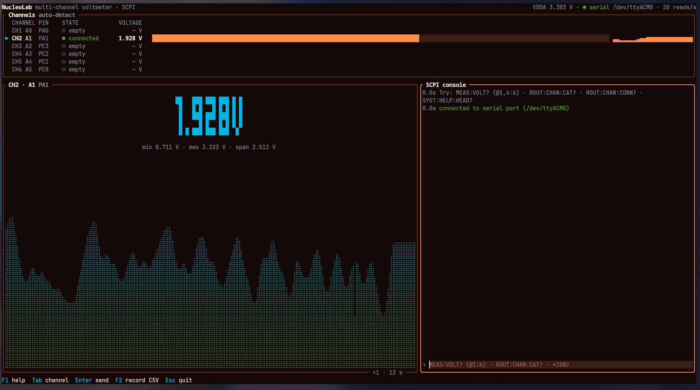
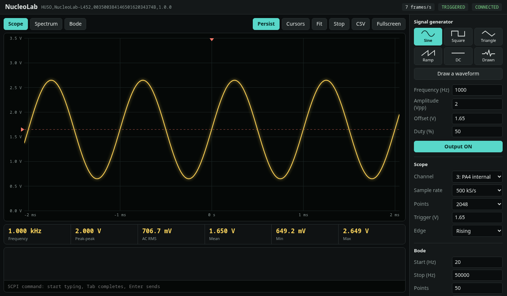
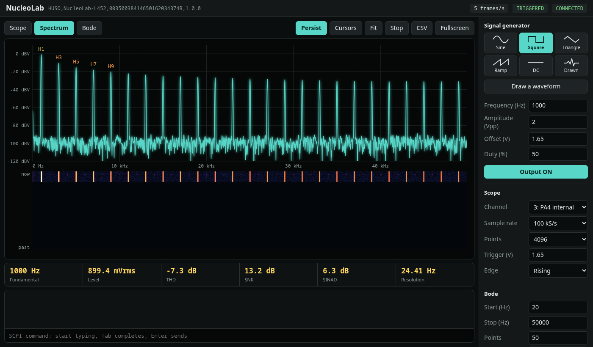

<h1 align="center">NucleoLab</h1>

<p align="center">
  Oscilloscope, signal generator, FFT / Bode analyzer and a 6-channel voltmeter with plug detection<br>
  on a NUCLEO-L452RE-P, all driven over <b>SCPI</b>. Bare-metal C firmware, a terminal UI in
  <a href="https://odin-lang.org">Odin</a> with <a href="https://github.com/Huseynteymurzade28/hnoss">hnoss</a>,
  and where it started: a <a href="https://ziglang.org">Zig</a> prototype.
</p>

<p align="center">
  <a href="https://github.com/Huseynteymurzade28/nucleolab/actions/workflows/ci.yml"></a>
</p>

<p align="center">
  
</p>

## Features

- **Voltmeter on A0–A5** that notices a wire being plugged in or pulled out within ~200 ms, by probing each pin with the MCU's own pull-up / pull-down. Running statistics, per-channel limits with status-register alarms, and a timestamped event log. → [docs/voltmeter.md](docs/voltmeter.md)
- **Scope**: 1 MS/s, 12-bit, 8192 points, triggered. **Generator**: sine, square, triangle, ramp, DC, arbitrary, 1 Hz – 100 kHz. **FFT** (THD, SNR, SINAD) and **Bode** gain / phase.
- **Own SCPI / IEEE 488.2 parser**: no heap, channel lists `(@1,3:5)`, binary blocks, status registers, fuzzed under ASan / UBSan. → [docs/scpi.md](docs/scpi.md)
- **Three front ends**: the terminal UI (live channels, console, CSV recording), a web panel, and any SCPI client through the bridge on port 5025. → [docs/tui.md](docs/tui.md)

## Quick start

```sh
git clone --recursive https://github.com/Huseynteymurzade28/nucleolab && cd nucleolab
make flash                       # build and program the board
make tui && tui/nucleolab-tui    # plug a potentiometer's wiper into any of A0–A5
```

For the web panel and PyVISA: `python3 -m venv .venv && .venv/bin/pip install -r requirements.txt`, then `./run.sh` (panel on <http://127.0.0.1:8080>, SCPI on port 5025). Quick commands from the shell: `tools/scpi.py 'MEAS:VOLT? (@1:6)'`.

> [!IMPORTANT]
> Inputs take 0–3.3 V only. Pins are set for the **-P** board. On a plain NUCLEO-L452RE, A2 / A3 and the LED sit elsewhere: see [docs/hardware.md](docs/hardware.md).

<p align="center">
  
  
</p>

## Docs

| | |
|---|---|
| [hardware.md](docs/hardware.md) | pins, wiring, -P vs plain board |
| [voltmeter.md](docs/voltmeter.md) | how plug detection works, statistics, limits, events |
| [scpi.md](docs/scpi.md) | every command and error code |
| [tui.md](docs/tui.md) | terminal UI keys, CSV, web panel |
| [development.md](docs/development.md) | layout, tests, CI, the Zig prototype, known limits |

## License

MIT. CMSIS under `third_party/` keeps its own license (Apache-2.0).
